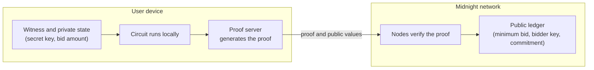

# How to build a private smart contract on Midnight

private 스마트 컨트랙트는 입력과 상태를 비밀로 유지하면서도, 모든 규칙이 지켜졌는지는 네트워크가 검증할 수 있습니다. Midnight에서는 컨트랙트를 Compact로 작성하고, 민감한 데이터는 사용자 기기에 남으며, 네트워크는 영지식 증명과 컨트랙트가 의도적으로 공개하는 값만 받습니다. 이 가이드를 끝까지 따라가면 private 입력을 갖춘 컴파일된 컨트랙트를 로컬 devnet에서 테스트한 상태가 됩니다.

{/* _mod-docs-content-type: REFERENCE */}
## How to build a private smart contract

Midnight에서 private 스마트 컨트랙트를 만들려면 다음 여섯 단계를 따릅니다:

1. [Set up your environment](#step-1-set-up-your-environment): Compact 툴체인, Docker, Node.js를 설치합니다.
2. [Decide what stays private and what goes public](#step-2-decide-what-stays-private-and-what-goes-public): 컨트랙트가 다루는 모든 데이터를 나열하고 각각을 어느 쪽에 둘지 정합니다.
3. [Write the contract in Compact](#step-3-write-the-contract-in-compact): public state를 `ledger`로 선언하고, 비밀은 private state에 두고, 체인에는 commitment나 해시만 저장하고, 값이 반드시 공개되어야 하는 곳에서만 `disclose()`를 씁니다.
4. [Compile the contract](#step-4-compile-and-understand-the-output): `compact compile`이 영지식 circuit과 키, TypeScript 바인딩을 생성합니다.
5. [Test on a local devnet](#step-5-test-on-a-local-devnet): 로컬 proof server로 컨트랙트를 배포하고 호출하므로 private 데이터가 사용자 기기에 남습니다.
6. [Deploy to Preprod](#step-6-deploy-to-preprod): 같은 코드를 공개 테스트 네트워크에서 실행합니다.

{/* _mod-docs-content-type: CONCEPT */}
## Why "private" in Solidity is not private

Solidity의 state 변수에 `private`를 붙인다고 해서 그 값이 비밀이 되지는 않습니다. [Solidity 문서](https://docs.soliditylang.org/en/latest/contracts.html#state-variable-visibility)는 이렇게 설명합니다. "무언가를 `private`나 `internal`로 지정하더라도, 다른 컨트랙트가 그 정보를 읽거나 수정하지 못하게 막을 뿐 블록체인 바깥의 모든 사람에게는 여전히 보입니다." 이 키워드는 어떤 코드가 변수에 접근할 수 있는지를 제어할 뿐, 누가 읽을 수 있는지는 제어하지 않습니다. 모든 노드가 컨트랙트의 데이터를 공개된 상태로 저장합니다.

진정한 프라이버시를 위해서는 민감한 데이터가 읽을 수 있는 형태로는 체인에 결코 도달하지 않는, 다른 실행 모델이 필요합니다. 프로젝트마다 접근 방식이 달라서, 영지식 롤업(예: Aztec), 완전 동형 암호(예: Zama FHEVM), 신뢰 실행 환경 등이 있습니다. Midnight은 영지식 증명을 사용합니다. 컨트랙트는 사용자 기기에서 실행되고, 체인은 그 실행에 대한 증명을 검증합니다.

{/* _mod-docs-content-type: CONCEPT */}
## How privacy works in a Midnight contract

Midnight 컨트랙트는 모든 상호작용을 사용자 기기에서 실행되는 private 부분과 네트워크가 검증하고 저장하는 public 부분으로 나눕니다. Compact는 그 분리를 코드에 드러냅니다:

- **프라이버시가 기본값입니다.** circuit 인자와 witness 결과는 직접 공개하지 않는 한 private입니다. 공개하려면 `disclose()` 어노테이션이 필요합니다.
- **`ledger` 필드는 public이며 온체인 컨트랙트 상태입니다.** 누구나 읽을 수 있습니다.
- **`circuit` 정의는 규칙을 담습니다.** 컴파일러가 이를 영지식 circuit으로 바꾸므로, 트랜잭션은 private 입력을 드러내지 않고도 규칙이 지켜졌음을 증명합니다.
- **`witness` 함수는 사용자 기기에서 오프체인으로 실행되며** local private state에 보관된 비밀 키처럼 private 데이터를 circuit에 제공합니다.
- **컴파일러가 그 경계를 강제합니다.** witness 데이터나 거기서 파생된 값이 `disclose()` 없이 public state, 내보낸 circuit의 반환값, 또는 컨트랙트 호출에 도달하는 프로그램은 모두 거부합니다.
- **어떤 동작은 항상 `disclose()`가 필요합니다.** 컴파일러는 ledger 쓰기, unshielded 토큰 전송, 컨트랙트 간 호출(Compact 툴체인 0.33.0 이상), 그리고 내보낸 circuit의 반환값을 private 데이터가 증명 밖으로 나가는 지점으로 취급합니다. ledger 쓰기와 unshielded 전송은 온체인에서 보입니다. 반환값은 ledger에 기록되지도 않고 트랜잭션에서 읽히지도 않으며, 트랜잭션은 호출의 입력과 출력에 대한 무작위화된 commitment만 담습니다. 그래도 반환값이 witness에서 온 경우 컴파일러는 `disclose()`를 요구하는데, 그 값이 DApp이나 호출하는 컨트랙트로 circuit을 떠나기 때문입니다.

`disclose()`는 그 자체로 값을 공개하지 않습니다. 그 값을 위 위치 중 하나로 넘기려 한다고 컴파일러에 알릴 뿐입니다. 전체 모델은 [Compact as a privacy-first language](../concepts/how-midnight-works/compact-privacy-first-language)와 [What is Midnight?](../what-is-midnight)의 public·private state 개요를 참고하세요.

다음 다이어그램은 각 부분이 어디서 실행되는지 보여 줍니다. witness, private state, 증명 생성은 사용자 기기에 남습니다. 네트워크는 증명과 public 값을 받아 증명을 검증하고 ledger를 업데이트합니다.



{/* _mod-docs-content-type: PROCEDURE */}
## Step 1: Set up your environment

Compact 툴체인, Node.js, Docker가 필요합니다. [Hello world](../getting-started/hello-world)의 스타터 리포지터리가 프로젝트 스캐폴딩, 로컬 네트워크, 그리고 Midnight.js로 만든 테스트 하네스를 제공합니다.

1. [Install the toolchain](../getting-started/installation)을 따라 다음을 설치합니다:

   - Compact CLI와 컴파일러 0.31.1 버전. [호환성 매트릭스](../relnotes/support-matrix)에 각 네트워크가 지원하는 버전이 나와 있습니다.
   - proof server와 로컬 네트워크를 실행하는 Docker.
   - 문법 강조를 위한 Compact VS Code 확장.

2. [Node.js](https://nodejs.org/) 22 버전 이상을 설치합니다. 스타터 리포지터리는 Yarn을 사용합니다. `yarn` 명령이 없으면 `corepack enable`을 실행하세요. 이 명령은 Node.js 22와 24에 함께 들어 있습니다.

3. 스타터 리포지터리를 클론하고 의존성을 설치합니다:

   ```bash
   git clone https://github.com/midnightntwrk/example-hello-world.git
   cd example-hello-world
   yarn install
   ```

   이후의 모든 명령은 `example-hello-world` 디렉터리에서 실행합니다.

### Verification

컴파일러 버전을 확인합니다:

```bash
compact compile --version
```

```text
0.31.1
```

{/* _mod-docs-content-type: REFERENCE */}
## Step 2: Decide what stays private and what goes public

코드를 작성하기 전에, 컨트랙트가 다루는 모든 데이터를 나열하고 각각이 경계의 어느 쪽에 속하는지 정하세요. 값은 네트워크나 다른 사용자가 읽어야 할 때만 public입니다.

이 가이드의 예제는 private 입찰 컨트랙트입니다. 입찰자는 공개된 최소 금액을 충족해야 하는 입찰을 제출합니다. 네트워크는 금액을 알지 못한 채 입찰이 최소 금액을 충족하는지 검증하고, 입찰자는 나중에 금액을 공개할 수 있습니다.

| 데이터 | private / public | 저장 위치 | 이유 |
|---|---|---|---|
| 최소 입찰액 | Public | `sealed ledger` 필드 | 모든 입찰자가 규칙을 알아야 하고, 배포 후에는 바뀌어서는 안 됩니다. |
| 입찰 금액 | Private | circuit 인자, 입찰자 기기 | 금액이 비밀입니다. 증명은 그 금액이 최소액을 충족함을 보여 줍니다. |
| 입찰자의 비밀 키 | Private | witness, local private state에서 | 컨트랙트에 입찰자를 식별해 주며 기기를 절대 떠나지 않습니다. |
| 입찰자 키 | Public, 해시 형태 | `ledger` map 키 | 컨트랙트는 입찰자마다 안정적인 식별자가 필요합니다. 비밀 키와 컨트랙트 주소의 해시는 키도 wallet address도 드러내지 않습니다. |
| 입찰 commitment | Public, commitment 형태 | `ledger` map 값 | 금액을 드러내지 않으면서 입찰자를 하나의 금액에 묶습니다. |
| 공개된 금액 | Public, 입찰자가 공개한 뒤에만 | `ledger` map 값 | 입찰자가 공개하기로 선택합니다. |

{/* _mod-docs-content-type: PROCEDURE */}
## Step 3: Write the contract in Compact

public 기준선에서 시작합니다. 다음은 [Hello world](../getting-started/hello-world)의 컨트랙트입니다:

```compact
pragma language_version 0.23;

export ledger message: Opaque<"string">;

export circuit storeMessage(newMessage: Opaque<"string">): [] {
  message = disclose(newMessage);
}
```

`newMessage` 인자는 처음에는 private이지만, `storeMessage`가 이를 disclose하여 ledger에 기록하므로 메시지는 public이 됩니다. private 컨트랙트는 같은 형태를 유지하되 ledger에 도달하는 것을 바꿉니다. 값 대신 commitment나 해시입니다.

`contracts/private-bid.compact`를 만들고 순서대로 쌓아 나갑니다. 각 블록을 파일 끝에 추가하되, 블록 사이에 빈 줄을 하나 둡니다.

1. 언어 버전을 선언하고, 표준 라이브러리를 import하고, `export ledger`로 public state를 선언합니다:

   ```compact title="contracts/private-bid.compact"
   pragma language_version 0.23;

   import CompactStandardLibrary;

   // Public state: every ledger field is stored on-chain.
   export sealed ledger minimumBid: Uint<64>;
   export ledger bidCommitments: Map<Bytes<32>, Bytes<32>>;
   export ledger revealedBids: Map<Bytes<32>, Uint<64>>;
   ```

   `sealed ledger` 필드는 constructor나 그것이 호출하는 보조 circuit만 설정할 수 있으므로, 최소 금액은 배포 후에 바뀔 수 없습니다.

2. 입찰자의 기기에서 비밀 키를 제공하는 `witness`를 선언합니다. Compact에서 witness는 본문이 없습니다. [Step 5](#step-5-test-on-a-local-devnet)에서 TypeScript로 구현합니다.

   ```compact
   // Private input: the witness runs on the bidder's device.
   witness localSecretKey(): Bytes<32>;
   ```

3. constructor에서 public 규칙을 설정합니다:

   ```compact
   constructor(minimum: Uint<64>) {
     // The minimum is a public rule, so the deployer discloses it.
     minimumBid = disclose(minimum);
   }
   ```

4. `persistentHash`로 비밀 키에서 값을 파생하는 보조 circuit을 추가합니다. 이 circuit은 각 값을 용도 레이블과, `kernel.self()`가 반환하는 이 컨트랙트의 주소에 묶습니다. 그러면 같은 비밀 키라도 다른 컨트랙트에서, 또는 이 컨트랙트의 다른 배포본에서 서로 무관한 값을 만들어 냅니다.

   ```compact
   // Derives a value that is unique to the secret key, this deployed contract, and one purpose.
   circuit derive(purpose: Bytes<32>, secretKey: Bytes<32>): Bytes<32> {
     return persistentHash<Vector<3, Bytes<32>>>([purpose, kernel.self().bytes, secretKey]);
   }
   ```

5. 입찰을 제출하는 `export circuit`을 작성합니다. 이 circuit은 비밀을 사용하고, 규칙을 확인하고, commitment만 저장합니다:

   ```compact
   export circuit placeBid(amount: Uint<64>): [] {
     const secretKey = localSecretKey();

     // The proof shows that the rule holds without revealing the amount.
     assert(amount >= minimumBid, "Bid is below the minimum");

     // The ledger needs a key for this bidder, so disclose the hash, not the secret.
     const bidder = disclose(derive(pad(32, "private-bid:key:"), secretKey));
     assert(!bidCommitments.member(bidder), "This bidder already placed a bid");

     // Store a commitment to the amount. The amount itself stays on the device.
     const salt = derive(pad(32, "private-bid:salt:"), secretKey);
     bidCommitments.insert(bidder, persistentCommit<Uint<64>>(amount, salt));
   }
   ```

   `persistentCommit`은 금액을, 그것을 감추는 두 번째 값과 함께 해시합니다. 여기서는 비밀 키에서 파생한 salt입니다. 컴파일러는 commitment가 입력을 감춘다고 보기 때문에, `persistentCommit` 결과는 `disclose()` 없이도 ledger에 올리는 것을 허용합니다. 다만 두 번째 인자가 무작위인지는 확인하지 않으므로, 비밀스럽고 엔트로피가 높은 값을 공급하는 것은 사용자의 책임입니다. 금액을 그냥 `persistentHash`한 값은 안전하지 않습니다. 입찰 금액은 추측할 수 있어서, 누구든 맞을 때까지 추측값을 해시해 볼 수 있습니다.

   salt는 한 입찰자의 모든 호출에서 동일합니다. 이 컨트랙트는 입찰자당 commitment를 하나만 받으므로 여기서는 안전합니다. 같은 사용자에 대해 두 번 이상 commit하는 컨트랙트라면 commitment마다 새로운 무작위 값을 쓰세요. 같은 값과 같은 salt는 항상 같은 commitment를 만들기 때문입니다.

6. 입찰을 공개하는 circuit을 작성합니다. 금액이 public이 되는 곳은 여기뿐입니다:

   ```compact
   export circuit revealBid(amount: Uint<64>): [] {
     const secretKey = localSecretKey();
     const bidder = disclose(derive(pad(32, "private-bid:key:"), secretKey));
     const salt = derive(pad(32, "private-bid:salt:"), secretKey);

     assert(bidCommitments.member(bidder), "This bidder has not placed a bid");
     assert(bidCommitments.lookup(bidder) == persistentCommit<Uint<64>>(amount, salt),
       "Amount does not match the committed bid");

     // The bidder chooses to publish the amount, so disclose it.
     revealedBids.insert(bidder, disclose(amount));
   }
   ```

:::note Witness or circuit argument

둘 다 데이터를 오프체인에 둡니다. 비밀 키는 입찰자의 private state에 있고 모든 호출이 이를 필요로 하므로, 컨트랙트는 witness를 통해 비밀 키를 읽습니다. 금액은 호출자가 호출마다 공급하므로 circuit 인자입니다.

:::

<details>
<summary>전체 컨트랙트</summary>

```compact title="contracts/private-bid.compact"
pragma language_version 0.23;

import CompactStandardLibrary;

// Public state: every ledger field is stored on-chain.
export sealed ledger minimumBid: Uint<64>;
export ledger bidCommitments: Map<Bytes<32>, Bytes<32>>;
export ledger revealedBids: Map<Bytes<32>, Uint<64>>;

// Private input: the witness runs on the bidder's device.
witness localSecretKey(): Bytes<32>;

constructor(minimum: Uint<64>) {
  // The minimum is a public rule, so the deployer discloses it.
  minimumBid = disclose(minimum);
}

// Derives a value that is unique to the secret key, this deployed contract, and one purpose.
circuit derive(purpose: Bytes<32>, secretKey: Bytes<32>): Bytes<32> {
  return persistentHash<Vector<3, Bytes<32>>>([purpose, kernel.self().bytes, secretKey]);
}

export circuit placeBid(amount: Uint<64>): [] {
  const secretKey = localSecretKey();

  // The proof shows that the rule holds without revealing the amount.
  assert(amount >= minimumBid, "Bid is below the minimum");

  // The ledger needs a key for this bidder, so disclose the hash, not the secret.
  const bidder = disclose(derive(pad(32, "private-bid:key:"), secretKey));
  assert(!bidCommitments.member(bidder), "This bidder already placed a bid");

  // Store a commitment to the amount. The amount itself stays on the device.
  const salt = derive(pad(32, "private-bid:salt:"), secretKey);
  bidCommitments.insert(bidder, persistentCommit<Uint<64>>(amount, salt));
}

export circuit revealBid(amount: Uint<64>): [] {
  const secretKey = localSecretKey();
  const bidder = disclose(derive(pad(32, "private-bid:key:"), secretKey));
  const salt = derive(pad(32, "private-bid:salt:"), secretKey);

  assert(bidCommitments.member(bidder), "This bidder has not placed a bid");
  assert(bidCommitments.lookup(bidder) == persistentCommit<Uint<64>>(amount, salt),
    "Amount does not match the committed bid");

  // The bidder chooses to publish the amount, so disclose it.
  revealedBids.insert(bidder, disclose(amount));
}
```

</details>

[Private party tutorial](../tutorials/private-party)은 같은 패턴으로 만든 더 큰 컨트랙트를 다루며, 그 위에 토큰 결제와 접근 제어를 더합니다.

{/* _mod-docs-content-type: PROCEDURE */}
## Step 4: Compile and understand the output

컴파일러는 프라이버시 경계를 확인한 다음, 내보낸 각 circuit을 자체 키를 가진 영지식 circuit으로 바꿉니다.

1. 컨트랙트를 컴파일합니다:

   ```bash
   compact compile contracts/private-bid.compact contracts/managed/private-bid
   ```

   첫 번째 인자는 소스 파일이고 두 번째는 출력 디렉터리입니다. 스타터의 `yarn compile` 스크립트는 아직 Hello world 컨트랙트를 가리키므로, `package.json`에서 같은 명령으로 업데이트합니다:

   ```json title="package.json"
   "compile": "compact compile contracts/private-bid.compact contracts/managed/private-bid",
   ```

2. `contracts/managed/private-bid`의 출력을 살펴봅니다:

   - `zkir/`의 **영지식 circuit**: 내보낸 circuit마다 하나씩, `placeBid`와 `revealBid`.
   - `keys/`의 **prover key와 verifier key**: proof server는 prover key로 증명을 생성하고, 네트워크는 verifier key로 이를 확인합니다.
   - `contract/`의 **JavaScript·TypeScript 바인딩**: `Contract` 클래스, `ledger` 리더, 그리고 DApp이 가져오는 타입들.

   네 번째 디렉터리인 `compiler/`에는 다른 도구를 위한 컨트랙트의 JSON 설명이 들어 있습니다.

### Verification

컴파일러가 두 circuit을 모두 보고합니다:

```text
Compiling 2 circuits:
  circuit "placeBid" (k=14, rows=10227)
  circuit "revealBid" (k=14, rows=10200)
Overall progress [====================] 2/2
```

컴파일러가 경계를 강제하는 것을 직접 보려면, `revealBid`의 마지막 줄에서 `disclose()`를 제거해 `revealedBids.insert(bidder, amount);`가 되도록 한 다음 다시 컴파일합니다. 컴파일러가 프로그램을 거부합니다:

```text
Exception: private-bid.compact line 48 char 15:
  potential witness-value disclosure must be declared but is not:
    witness value potentially disclosed:
      the value of parameter amount of exported circuit revealBid at line 38 char 26
    nature of the disclosure:
      ledger operation might disclose the witness value
    via this path through the program:
      the second argument to insert at line 48 char 15
```

이 메시지는 private 값(`amount`), 그 값이 public이 될 지점(ledger 연산), 그리고 둘 사이의 경로를 알려 줍니다. 파일의 간격이 다르면 줄 번호도 달라집니다. 오류를 고치려면 값이 ledger에 도달하지 못하게 막거나, 공개가 의도라면 다시 `disclose()`로 감싸세요:

```compact
revealedBids.insert(bidder, disclose(amount));
```

계속하기 전에 그 줄을 복원하고 다시 컴파일하세요.

{/* _mod-docs-content-type: PROCEDURE */}
## Step 5: Test on a local devnet

스타터 리포지터리는 Docker에서 로컬 devnet을 실행합니다. Midnight node, indexer, proof server로 구성됩니다. 이 테스트 하네스는 Midnight.js로 로컬 devnet에 미리 자금이 지급된 지갑을 써서 컨트랙트를 배포하고 호출합니다. proof server가 모든 증명을 로컬에서 생성하므로 입찰 금액과 비밀 키는 사용자 기기를 떠나지 않습니다.

1. witness를 구현합니다. `contracts/witnesses.ts`를 만듭니다:

   ```typescript title="contracts/witnesses.ts"
   import type { Witnesses } from './managed/private-bid/contract/index.js';

   // Private state lives on the bidder's device and never reaches the network.
   export type PrivateBidPrivateState = {
     readonly secretKey: Uint8Array;
   };

   export const witnesses: Witnesses<PrivateBidPrivateState> = {
     // Returns the unchanged private state and the value the circuit asked for.
     localSecretKey: ({ privateState }) => [privateState, privateState.secretKey],
   };
   ```

   생성된 `Witnesses` 타입은 컨트랙트가 선언한 모든 witness에 올바른 반환 타입의 구현이 있는지 확인합니다.

2. 프로젝트가 새 컨트랙트를 가리키게 합니다. `contracts/index.ts`의 내용을 교체합니다:

   ```typescript title="contracts/index.ts"
   import { CompiledContract } from '@midnight-ntwrk/midnight-js-protocol/compact-js';
   import path from 'node:path';

   export {
     Contract,
     ledger,
     type Ledger,
   } from './managed/private-bid/contract/index.js';
   export { witnesses, type PrivateBidPrivateState } from './witnesses.js';
   import { Contract } from './managed/private-bid/contract/index.js';
   import { witnesses } from './witnesses.js';

   const currentDir = path.resolve(new URL(import.meta.url).pathname, '..');
   export const zkConfigPath = path.resolve(currentDir, 'managed', 'private-bid');

   export const CompiledPrivateBidContract = CompiledContract.make(
     'PrivateBidContract',
     Contract,
   ).pipe(
     CompiledContract.withWitnesses(witnesses),
     CompiledContract.withCompiledFileAssets(zkConfigPath),
   );
   ```

3. 테스트 파일을 교체합니다. `src/test/hw.test.ts`를 삭제하고 아래 전체 파일로 `src/test/private-bid.test.ts`를 만듭니다. 지갑과 provider 설정은 스타터 자체의 것이고, 이 컨트랙트에 고유한 부분은 `contracts/index.js`에서 가져오는 import, `call` 헬퍼, 그리고 다섯 개의 테스트입니다:

   ```typescript title="src/test/private-bid.test.ts (tests only)"
     const MINIMUM_BID = 100n;
     const BID = 250n;

     // Calls a circuit of the deployed contract with the local private state.
     const call = (circuitId: 'placeBid' | 'revealBid', amount: bigint) =>
       submitCallTx(providers, {
         compiledContract: CompiledPrivateBidContract,
         contractAddress,
         privateStateId: PRIVATE_STATE_ID,
         circuitId,
         args: [amount],
       });

     it('Deploys the contract with a public minimum bid', async () => {
       // The secret key is created on this machine and stays in private state.
       const initialPrivateState: PrivateBidPrivateState = {
         secretKey: randomBytes(32),
       };

       const deployed = await deployContract(providers, {
         compiledContract: CompiledPrivateBidContract,
         privateStateId: PRIVATE_STATE_ID,
         initialPrivateState,
         args: [MINIMUM_BID],
       });
       contractAddress = deployed.deployTxData.public.contractAddress;
       logger.info(`Contract deployed at: ${contractAddress}`);

       const state = await queryLedger(providers);
       expect(state.minimumBid).toEqual(MINIMUM_BID);
       expect(state.bidCommitments.isEmpty()).toBe(true);
     });

     it('Rejects a bid below the minimum', async () => {
       await expect(call('placeBid', 50n)).rejects.toThrow(
         'Bid is below the minimum',
       );
     });

     it('Places a bid without putting the amount on the ledger', async () => {
       await call('placeBid', BID);

       const state = await queryLedger(providers);
       const [[bidder, commitment]] = [...state.bidCommitments];
       logger.info(`Bidder key:  ${Buffer.from(bidder).toString('hex')}`);
       logger.info(`Commitment:  ${Buffer.from(commitment).toString('hex')}`);
       expect(state.bidCommitments.size()).toEqual(1n);
       expect(state.revealedBids.isEmpty()).toBe(true);
     });

     it('Rejects a reveal that does not match the commitment', async () => {
       await expect(call('revealBid', 300n)).rejects.toThrow(
         'Amount does not match the committed bid',
       );
     });

     it('Reveals the bid when the bidder chooses to', async () => {
       await call('revealBid', BID);

       const state = await queryLedger(providers);
       const [[, amount]] = [...state.revealedBids];
       expect(amount).toEqual(BID);
     });
   });
   ```

   <details>
   <summary>전체 테스트 파일</summary>

   ```typescript title="src/test/private-bid.test.ts"
   import { describe, it, expect, beforeAll, afterAll } from 'vitest';
   import { WebSocket } from 'ws';
   import { setNetworkId } from '@midnight-ntwrk/midnight-js-network-id';
   import {
     deployContract,
     submitCallTx,
   } from '@midnight-ntwrk/midnight-js-contracts';
   import type { ContractAddress } from '@midnight-ntwrk/midnight-js-protocol/compact-runtime';
   import {
     type EnvironmentConfiguration,
     waitForFunds,
   } from '@midnight-ntwrk/testkit-js';
   import pino from 'pino';

   import { getConfig } from '../config.js';
   import {
     MidnightWalletProvider,
     syncWallet,
     type WalletSecret,
   } from '../wallet.js';
   import { buildProviders, type HelloWorldProviders } from '../providers.js';
   import { randomBytes } from 'node:crypto';
   import {
     CompiledPrivateBidContract,
     ledger,
     zkConfigPath,
     type PrivateBidPrivateState,
   } from '../../contracts/index.js';

   // Required for GraphQL subscriptions in Node.js
   // @ts-expect-error WebSocket global assignment for apollo
   globalThis.WebSocket = WebSocket;

   process.on('unhandledRejection', (reason, promise) => {
     console.error('UNHANDLED REJECTION:', reason);
     console.error('Promise:', promise);
   });

   process.on('uncaughtException', (err) => {
     console.error('UNCAUGHT EXCEPTION:', err);
   });

   const ALICE_LOCAL_SEED =
     '0000000000000000000000000000000000000000000000000000000000000001';
   const PRIVATE_STATE_ID = 'AlicePrivateBidState';

   const logger = pino({
     level: process.env['LOG_LEVEL'] ?? 'info',
     transport: { target: 'pino-pretty' },
   });

   const network = process.env['MIDNIGHT_NETWORK'] ?? 'local';

   function resolveSecret(net: string): WalletSecret {
     if (net === 'local') return { kind: 'seed', value: ALICE_LOCAL_SEED };

     const upper = net.toUpperCase();
     const mnemonicEnv = `MIDNIGHT_${upper}_MNEMONIC`;
     const seedEnv = `MIDNIGHT_${upper}_SEED`;
     const mnemonic = process.env[mnemonicEnv]?.trim().replace(/\s+/g, ' ');
     const seedHex = process.env[seedEnv]?.trim();

     if (mnemonic && seedHex) {
       throw new Error(
         `Set only one of ${mnemonicEnv} or ${seedEnv} (both are defined).`,
       );
     }
     if (mnemonic) {
       return { kind: 'mnemonic', value: mnemonic };
     }
     if (seedHex) {
       if (!/^[0-9a-fA-F]+$/.test(seedHex) || seedHex.length % 2 !== 0) {
         throw new Error(
           `${seedEnv} must be a hex string of even length (no 0x prefix).`,
         );
       }
       return { kind: 'seed', value: seedHex };
     }
     throw new Error(
       `Either ${mnemonicEnv} or ${seedEnv} is required for network '${net}'. ` +
         `Set one in .env.${net} or the shell.`,
     );
   }

   describe(`Private Bid Contract (${network})`, () => {
     let wallet: MidnightWalletProvider;
     let providers: HelloWorldProviders;
     let contractAddress: ContractAddress;

     const config = getConfig();
     const secret = resolveSecret(network);
     const isRemote = network !== 'local';
     const syncTimeoutMs = Number(
       process.env['MIDNIGHT_SYNC_TIMEOUT_MS'] ??
         (isRemote ? 60 * 60_000 : 10 * 60_000),
     );

     async function queryLedger(p: HelloWorldProviders) {
       const state = await p.publicDataProvider.queryContractState(contractAddress);
       expect(state).not.toBeNull();
       return ledger(state!.data);
     }

     beforeAll(async () => {
       setNetworkId(config.networkId);

       const envConfig: EnvironmentConfiguration = {
         walletNetworkId: config.networkId,
         networkId: config.networkId,
         indexer: config.indexer,
         indexerWS: config.indexerWS,
         node: config.node,
         nodeWS: config.nodeWS,
         faucet: config.faucet,
         proofServer: config.proofServer,
       };

       wallet = await MidnightWalletProvider.build(logger, envConfig, secret);
       await wallet.start();
       await syncWallet(logger, wallet.wallet, syncTimeoutMs);

       if (isRemote) {
         // NIGHT→DUST registration. Seed is pre-funded via the faucet page; idempotent.
         const nightBalance = await waitForFunds(
           wallet.wallet,
           envConfig,
           false,
           wallet.unshieldedKeystore,
         );
         logger.info(`Wallet NIGHT balance on '${network}': ${nightBalance}`);
       }

       providers = buildProviders(wallet, zkConfigPath, config);
       logger.info(`Providers initialized on '${network}'. Ready to test!`);
     });

     afterAll(async () => {
       if (wallet) {
         logger.info('Stopping wallet...');
         await wallet.stop();
       }
     });

     const MINIMUM_BID = 100n;
     const BID = 250n;

     // Calls a circuit of the deployed contract with the local private state.
     const call = (circuitId: 'placeBid' | 'revealBid', amount: bigint) =>
       submitCallTx(providers, {
         compiledContract: CompiledPrivateBidContract,
         contractAddress,
         privateStateId: PRIVATE_STATE_ID,
         circuitId,
         args: [amount],
       });

     it('Deploys the contract with a public minimum bid', async () => {
       // The secret key is created on this machine and stays in private state.
       const initialPrivateState: PrivateBidPrivateState = {
         secretKey: randomBytes(32),
       };

       const deployed = await deployContract(providers, {
         compiledContract: CompiledPrivateBidContract,
         privateStateId: PRIVATE_STATE_ID,
         initialPrivateState,
         args: [MINIMUM_BID],
       });
       contractAddress = deployed.deployTxData.public.contractAddress;
       logger.info(`Contract deployed at: ${contractAddress}`);

       const state = await queryLedger(providers);
       expect(state.minimumBid).toEqual(MINIMUM_BID);
       expect(state.bidCommitments.isEmpty()).toBe(true);
     });

     it('Rejects a bid below the minimum', async () => {
       await expect(call('placeBid', 50n)).rejects.toThrow(
         'Bid is below the minimum',
       );
     });

     it('Places a bid without putting the amount on the ledger', async () => {
       await call('placeBid', BID);

       const state = await queryLedger(providers);
       const [[bidder, commitment]] = [...state.bidCommitments];
       logger.info(`Bidder key:  ${Buffer.from(bidder).toString('hex')}`);
       logger.info(`Commitment:  ${Buffer.from(commitment).toString('hex')}`);
       expect(state.bidCommitments.size()).toEqual(1n);
       expect(state.revealedBids.isEmpty()).toBe(true);
     });

     it('Rejects a reveal that does not match the commitment', async () => {
       await expect(call('revealBid', 300n)).rejects.toThrow(
         'Amount does not match the committed bid',
       );
     });

     it('Reveals the bid when the bidder chooses to', async () => {
       await call('revealBid', BID);

       const state = await queryLedger(providers);
       const [[, amount]] = [...state.revealedBids];
       expect(amount).toEqual(BID);
     });
   });
   ```

   </details>

4. proof server를 포함하는 로컬 devnet을 시작합니다:

   ```bash
   yarn env:up
   ```

5. 미리 자금이 지급된 지갑이 수수료를 낼 수 있을 때까지 기다립니다. 갓 띄운 devnet은 그 지갑을 위한 DUST를 생성하는 데 몇 초가 걸리며, 그 전에 배포하면 `Wallet.InsufficientFunds`로 실패합니다:

   ```bash
   yarn wait:dust
   ```

6. 테스트를 실행합니다:

   ```bash
   yarn test:local
   ```

### Verification

실행이 끝나면 다섯 테스트가 모두 통과합니다:

```text
[14:42:34.953] INFO (81529): Providers initialized on 'local'. Ready to test!
[14:42:57.063] INFO (81529): Contract deployed at: f57d950b4ead7c06194fb09699ee173e31155d56efc0eb5fc43ffdebbde06cf3
[14:43:21.080] INFO (81529): Bidder key:  0cb7214533e92fd1c358ea86176e3ac1048354d4314fb992f0498fba1313f432
[14:43:21.080] INFO (81529): Commitment:  1cebbecc9f752886923cbcfef116a04703182ffa1337cb7ca6ed906e5a03e0b0
 ✓ src/test/private-bid.test.ts (5 tests) 69514ms
     ✓ Deploys the contract with a public minimum bid  22119ms
     ✓ Places a bid without putting the amount on the ledger  23938ms
     ✓ Reveals the bid when the bidder chooses to  22685ms

 Test Files  1 passed (1)
      Tests  5 passed (5)
```

컨트랙트 주소, 키, 소요 시간은 사용자마다 다릅니다. 테스트 러너는 300ms보다 오래 걸리는 테스트만 나열합니다. 거부되는 두 호출은 proof server가 증명을 생성하기 전에 사용자 기기에서 실패하므로, 보통 그보다 빨리 끝납니다.

체인을 지켜보는 관찰자가 각 단계에서 알게 되는 것:

- 배포 후: 최소 입찰액.
- `placeBid` 후: 최소액 이상의 입찰이 존재한다는 사실, 불투명한 입찰자 키, 불투명한 commitment. 금액인 250은 컨트랙트의 public state에 없습니다.
- `revealBid` 후: 같은 입찰자 키에 연결된 금액. 공개란 바로 이를 위한 것입니다.
- 항상: 입찰 수, 그리고 각 트랜잭션이 호출한 circuit.

증명 생성에는 시간이 걸립니다. 이번 실행에서는 각 트랜잭션이 호출부터 로컬 devnet에서의 확정까지 22~24초가 걸렸습니다.

끝나면 devnet을 중지합니다:

```bash
yarn env:down
```

{/* _mod-docs-content-type: PROCEDURE */}
## Step 6: Deploy to Preprod

Preprod는 공개 Midnight 테스트 네트워크입니다. 컨트랙트와 테스트 코드는 바뀌지 않습니다. 바뀌는 것은 네트워크 설정과 지갑뿐이고, proof server는 여전히 사용자 기기에서 실행됩니다.

1. Preprod 네트워크에서 지갑에 tNIGHT으로 자금을 넣고 DUST 생성을 위해 등록합니다. Lace wallet이나 wallet SDK로 할 수 있습니다. [Funding a wallet](./acquire-tokens)이 두 방법을 모두 다룹니다.

2. 예제 환경 파일을 복사하고 그 안에 wallet secret 하나를, 니모닉이나 seed 중 하나를 설정합니다:

   ```bash
   cp .env.preprod.example .env.preprod
   ```

   리포지터리의 `.gitignore`가 `.env.preprod`를 제외합니다. 절대 커밋하거나 공유하지 마세요.

3. 로컬 proof server를 시작합니다:

   ```bash
   yarn proof:up
   ```

4. 같은 테스트를 Preprod에 대해 실행합니다:

   ```bash
   yarn test:preprod
   ```

   Preprod에서 지갑의 첫 동기화는 로컬 devnet보다 훨씬 오래 걸립니다.

이 스크립트들 뒤에 있는 배포 코드와 블록 탐색기에서 배포를 확인하는 방법은 [Promoting a deployment to Preprod](./deploy-and-operate#promoting-a-deployment-to-preprod)를 참고하세요.

{/* _mod-docs-content-type: REFERENCE */}
## Common mistakes

- **필요 이상으로 공개하기.** `disclose()`는 그 안에 감싼 것이 무엇이든 컴파일러를 잠잠하게 만듭니다. 원본 입력이 아니라 해시, commitment, 검사 결과처럼 목적을 이루는 가장 좁은 값만 disclose하세요.
- **내보낸 circuit에서 private 값을 반환하기.** 반환값은 증명을 벗어나 circuit을 호출한 코드로 가므로, 컴파일러는 witness에서 파생된 반환값에는 `disclose()`를 요구합니다. private 값은 circuit 안에 두고, 아무것도 반환하지 않거나 commitment를 반환하세요.
- **unshielded 전송이 private라고 가정하기.** NIGHT을 포함한 unshielded 토큰은 공개적으로 이동합니다. unshielded 결제를 받는 컨트랙트는 지불자와 금액을 드러냅니다.
- **commitment 대신 원본 개인정보를 ledger에 저장하기.** 모든 ledger 필드는 public입니다. 무작위 값과 함께 `persistentCommit`을 저장하고, 데이터는 private state에 두세요. 추측할 수 있는 값을 그냥 해시한 것은 누구든 추측으로 되돌릴 수 있습니다.

## Next steps

- [Private party tutorial](../tutorials/private-party/smart-contract): 토큰 결제와 접근 제어를 갖춘 더 큰 private 컨트랙트의 전체 과정.
- [Tutorials](../tutorials): 비공개 파티부터 ZK 대출까지 완성된 DApp들.
- [Compact language](../compact): [explicit disclosure](../compact/reference/explicit-disclosure)를 포함한 언어 레퍼런스.
- [Midnight.js](/sdks/official/midnight-js): 컨트랙트를 배포하고 호출하는 TypeScript 프레임워크.
- [Security and best practices](./security-best-practices): 호출자를 인증하고, 입력을 검증하고, 재전송을 방지합니다.
- [The Developer Experience of Building on Midnight](https://midnight.network/blog/Developer-Experience): 툴링 개요.
- [Midnight Developer Hub](https://midnight.network/developer-hub): 개발자 진입점.

## Frequently asked questions

### How do you build a private smart contract?

어떤 데이터가 private로 남아야 하고 어떤 데이터가 public이어야 하는지 정한 다음, private 데이터를 오프체인에 두고 영지식 증명으로 올바른 실행을 증명하는 플랫폼을 사용하세요. Midnight에서는 컨트랙트를 Compact로 작성하고, 비밀은 사용자 기기에서 실행되는 witness에 보관하고, public이 되어야 하는 값은 `disclose()`로 표시한 뒤, 컴파일하고 로컬 devnet에서 테스트합니다.

### Are private variables in Solidity actually private?

아니요. Solidity 문서에 따르면 `private`와 `internal`은 다른 컨트랙트가 데이터를 읽거나 수정하지 못하게 막을 뿐입니다. 블록체인 바깥의 누구에게나 여전히 보입니다. 비밀 데이터에는 민감한 값이 public ledger에 결코 도달하지 않는, 다른 모델이 필요합니다.

### What is a private smart contract?

private 스마트 컨트랙트는 블록체인에서 실행되지만 입력과 상태의 일부 또는 전부를 비밀로 유지하며, 그러면서도 네트워크는 컨트랙트의 규칙이 지켜졌는지 검증할 수 있습니다. 흔한 기법으로는 영지식 증명, 완전 동형 암호, 신뢰 실행 환경이 있습니다. Midnight은 영지식 증명을 사용합니다.

### Do I need to know cryptography to build a private smart contract on Midnight?

아니요. circuit이나 증명을 직접 손으로 작성하지 않습니다. Compact는 TypeScript와 비슷한 문법을 가지며, 컴파일러가 영지식 circuit을 대신 생성합니다. 무엇을 private로, 무엇을 public으로 둘지 정하고, 해시나 commitment로 값을 보호할 위치를 선택하면 됩니다.

### What does `disclose()` do in Compact?

`disclose()`는 private 값을 ledger 필드 같은 public 위치로 넘기려 한다고 컴파일러에 알리며, 이것이 없으면 컴파일러는 프로그램을 거부합니다. 그 자체로 값을 공개하지는 않습니다. [How privacy works in a Midnight contract](#how-privacy-works-in-a-midnight-contract)를 참고하세요.

### Where is private data stored in a Midnight contract?

private 데이터는 사용자 기기의 local private state에 남아, witness와 circuit 인자를 통해 circuit에 공급되며, 네트워크에는 증명과 의도적으로 공개한 값만 도달합니다. proof server는 증명을 만드는 동안 private 입력을 보게 되므로, 사용자가 통제하는 기기에서 실행하세요. [Step 5](#step-5-test-on-a-local-devnet)를 참고하세요.

### Can I test a private smart contract locally?

네. 로컬 devnet에는 미리 자금이 지급된 지갑들과 Docker의 proof server가 함께 제공되므로, Preprod로 넘어가기 전에 컨트랙트를 배포하고 호출할 수 있습니다. [Step 5](#step-5-test-on-a-local-devnet)에서 보여 줍니다.
