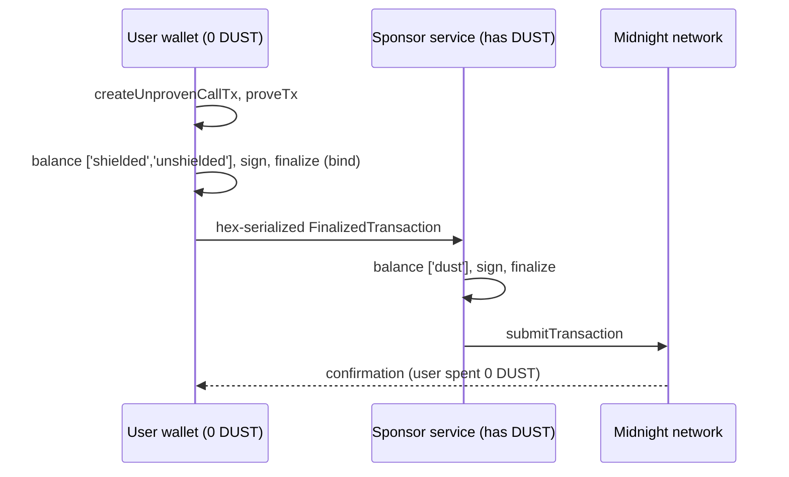

# Sponsor transaction fees with DUST

DUST sponsorship에서는 한 지갑이 다른 지갑을 대신해 트랜잭션 수수료를 낼 수 있습니다. 사용자는 동작을 승인하고, sponsor는 DUST 수수료를 내며, 두 역할은 결코 섞이지 않습니다. 그 결과는 gasless 경험입니다. DUST이 0인 사용자도 첫 클릭부터 트랜잭션을 할 수 있습니다.

:::info 이 페이지가 전제하는 것
Midnight 트랜잭션에 [DUST](../concepts/dust-architecture.mdx)이 든다는 것, DUST이 DUST 생성용으로 등록된 NIGHT에서 생성된다는 것, 그리고 circuit이 사용자 기기에서 실행된다는 것을 알고 있다고 가정합니다. 이 페이지의 모든 코드는 midnight-examples의 [`examples/private-party`](https://github.com/midnightntwrk/midnight-examples/tree/main/examples/private-party) 레퍼런스 구현에서 가져왔으며, 그 [SPONSORSHIP.md](https://github.com/midnightntwrk/midnight-examples/blob/main/examples/private-party/docs/SPONSORSHIP.md)에 요약되어 있습니다. 테스트된 구성 요소 버전은 [support matrix](../relnotes/support-matrix.mdx)를 확인하세요.
:::

## The problem sponsorship solves

새 사용자가 지갑을 설치하고 DApp을 연 뒤 버튼을 클릭합니다. 아무 일도 일어나지 않습니다. 트랜잭션에는 DUST이 들고, DUST은 등록된 NIGHT을 오랫동안 보유해서 생기는데, 갓 시작한 사용자에게는 둘 다 없습니다. sponsorship은 온보딩 플로우, 무료 등급, 그리고 조직이 사용량을 부담하는 엔터프라이즈 배포에서 그 벽을 없앱니다.

## The principle: who pays is not who is authorized

| 역할 | 보유 | 가능 | 불가능 |
|---|---|---|---|
| User | 컨트랙트 비밀, DUST 0 | 동작을 증명하고 승인 | 수수료 납부 |
| Sponsor | DUST 생성용으로 등록된 NIGHT | DUST 수수료 offer를 추가하고 제출 | 사용자 행세, sealed 트랜잭션 변경, 또는 사용자 비밀 접근 |

세 가지 메커니즘이 이 분리를 강제합니다:

1. **스마트 컨트랙트는 수수료 납부자가 아니라 비밀로 인증합니다.** 레퍼런스 예제에서 `checkIn` circuit은 `commitAddress(_secret, address.bytes)`가 ledger의 RSVP와 일치하도록 요구합니다. 비밀을 아는 호출자만 유효한 증명을 만들 수 있으므로, sponsor의 돈은 수수료 말고는 아무것도 사지 못합니다.
2. **사용자가 먼저 트랜잭션을 바인딩합니다.** 사용자는 넘기기 전에 증명하고, 자기 쪽을 balance하고, 서명하고, finalize합니다. 네트워크로 건너가는 것은 sponsor가 DUST 수수료 offer를 추가할 수 있는 바인딩된 `FinalizedTransaction` 하나뿐이고, 그 외에는 없습니다.
3. **네트워크는 변경된 트랜잭션을 거부합니다.** 암호학적 바인딩이 컨트랙트 호출을 트랜잭션에 묶습니다. finalize 이후 무엇이든 바꾸면 검증이 실패합니다.

:::danger ownPublicKey()로 절대 인증하지 마세요
`ownPublicKey()`은 witness입니다. prover의 기계가 그 반환값을 정하며, 프로토콜은 이를 서명하는 지갑과 대조하지 않습니다. 이를 바탕으로 한 검사는 sponsor든 다른 누구든 우회할 수 있습니다. 권한 부여는 레퍼런스 컨트랙트처럼 비밀 지식을 증명하는 데서 와야 합니다. `ownPublicKey()`은 토큰을 호출자에게 보내는 용도로만 쓰세요.
:::

## The flow



이 분리는 `tokenKindsToBalance`라는 옵션 하나로 강제됩니다. 사용자는 트랜잭션의 값을 충당하려고 `['shielded', 'unshielded']`를 balance하고, sponsor는 수수료를 충당하려고 `['dust']`를 balance합니다. 사용자가 항상 prover이므로, 호출자를 인증하는 비밀은 결코 sponsor에 도달하지 않습니다.

## The user side: prove, balance, bind

레퍼런스 구현의 `src/sponsor.ts`에서 가져왔습니다. 이 함수가 반환하는 hex 문자열이 네트워크 경계입니다. 프로덕션에서 이 함수는 브라우저 지갑처럼 사용자의 키가 있는 곳에서 실행됩니다.

```ts title="src/sponsor.ts (user side)"
export async function prepareSponsoredCall<
  C extends Contract.Any,
  PCK extends Contract.ProvableCircuitId<C>,
>(
  logger: Logger,
  user: MidnightWalletProvider,
  providers: PartyProviders,
  call: CallTxOptionsWithPrivateStateId<C, PCK>,
): Promise<string> {
  const unsubmitted = await createUnprovenCallTx<C, PCK>(providers, call);

  // Proving happens here, on the user's side — which is why the secret that
  // authenticates the caller never reaches the sponsor.
  const unboundTx = await providers.proofProvider.proveTx(unsubmitted.private.unprovenTx);

  // Balance only the user's own value side (no DUST), sign, and bind.
  const finalized = await user.balanceOwnValueAndFinalize(unboundTx);

  return toHex(finalized.serialize());
}
```

여기에 없는 것에 주목하세요. DUST도, 수수료 추정도, sponsor 키도 없습니다. DUST이 0인 지갑도 모든 줄을 실행할 수 있습니다. `balanceOwnValueAndFinalize` 안에서 지갑은 `tokenKindsToBalance: ['shielded', 'unshielded']`로 `balanceUnboundTransaction`을 호출한 뒤 `signRecipe`, 그다음 `finalizeRecipe`를 호출합니다.

## The sponsor side: pay the fee, submit

보통은 작은 백엔드 서비스입니다. 무언가를 쓰기 전에 rate limit이나 allowlist 같은 수락 정책을 적용할 수 있습니다.

```ts title="src/sponsor.ts (sponsor side)"
export async function sponsorAndSubmit(
  logger: Logger,
  sponsor: MidnightWalletProvider,
  userTxHex: string,
): Promise<string> {
  // The marker triple matches FinalizedTransaction = Transaction<SignatureEnabled, Proof, Binding>.
  const userTx = Transaction.deserialize<SignatureEnabled, Proof, Binding>(
    'signature',
    'proof',
    'binding',
    fromHex(userTxHex),
  );

  // Attach a DUST fee offer paid by the sponsor, then submit.
  const sponsored = await sponsor.addDustFeesAndFinalize(userTx);

  const txId = await sponsor.wallet.submitTransaction(sponsored);
  return txId;
}
```

`addDustFeesAndFinalize` 안에서 지갑은 `tokenKindsToBalance: ['dust']`로 `balanceFinalizedTransaction`을 호출한 뒤 `signRecipe`, 그다음 `finalizeRecipe`를 호출합니다. sponsor는 납부자일 뿐 결코 작성자가 아닙니다.

## Why the order is important

사용자가 **먼저** 증명하고, balance하고, 서명하고, finalize합니다. sponsor는 이미 바인딩된 트랜잭션을 받으므로, 보장이 메커니즘 자체에서 자연히 따라 나옵니다:

| 보장 | 성립하는 이유 |
|---|---|
| sponsor는 호출을 변경할 수 없다 | 트랜잭션은 넘기기 전에 바인딩되며, 네트워크가 변경을 거부한다 |
| sponsor는 비밀에 접근할 수 없다 | 사용자가 증명을 생성했고, 증명만 전달된다 |
| sponsor는 사용자 행세를 할 수 없다 | 컨트랙트가 비밀로 인증하는데, sponsor는 그 비밀을 가지고 있지 않다 |
| 사용자는 sponsor의 자금을 쓸 수 없다 | sponsor는 `['dust']`만 balance하고, 자기 추가분에 서명하며, 정책을 먼저 적용한다 |
| sponsor에게서 DUST을 빼낼 수 없다 | DUST은 전송할 수 없으며, sponsor가 승인한 수수료에만 쓸 수 있다 |

:::warning 이 순서를 정확히 지키세요
사용자가 balance되지 않았거나 서명되지 않은 트랜잭션을 넘기면, 받는 쪽이 그것을 바꿀 수 있습니다. 무엇이든 사용자 기기를 떠나기 전에 사용자 쪽에서 balance하고, 서명하고, finalize하세요.
:::

## Run the reference example

이 구현은 midnight-examples의 [`examples/private-party`](https://github.com/midnightntwrk/midnight-examples/tree/main/examples/private-party)에 들어 있으며, 여기서 DUST이 0인 손님이 파티에 체크인하는 동안 sponsor가 수수료를 냅니다.

```bash
yarn env:up             # start the local environment
yarn wait:dust          # wait until the sponsor wallet has generated DUST
yarn test:sponsorship   # run the sponsored flow, including the negative cases
yarn sponsor:serve      # or run the sponsor as an HTTP service
```

| 파일 | 내용 |
|---|---|
| `src/sponsor.ts` | `prepareSponsoredCall`(사용자 쪽)과 `sponsorAndSubmit`(sponsor 쪽) |
| `src/wallet.ts` | 위에서 설명한 역할별 balancing 메서드 |
| `src/test/sponsorship.test.ts` | 보안 검증: sponsored happy path, 그리고 납부자는 행동할 수 없고 행위자는 낼 수 없음을 입증 |
| `scripts/sponsor-service.ts` | 작은 HTTP 서비스로서의 sponsor |

이 패턴을 도입하려면 자신의 스마트 컨트랙트로 바꿔 넣으세요. 컨트랙트가 권한 부여 규칙을 제공하며, 두 함수와 그 순서는 그대로입니다.

## Reference

**토큰 단위:**

| 리소스 | 최소 단위 | 비율 |
|---|---|---|
| NIGHT | STAR | 1 NIGHT = 10^6 STAR |
| DUST | SPECK | 1 DUST = 10^15 SPECK |

**sponsor 경제성을 좌우하는 DUST 사실:** DUST은 전송할 수 없고 수수료만 냅니다. 등록된 NIGHT에서 cap을 향해 생성되며, 초기 파라미터 기준으로 NIGHT당 대략 5 DUST이고, backing NIGHT이 쓰이면 감소합니다. 트랜잭션 전체에 대한 수수료는 guaranteed phase에서 걷히므로, fallible phase에서 실패해도 수수료는 그대로 소비됩니다. 현재 프로토콜에서 스마트 컨트랙트는 DUST을 보유하거나 쓰지 않습니다. sponsorship은 지갑 쪽 메커니즘입니다.

**마주칠 수 있는 오류**(제출 실패는 `1010: Invalid Transaction: Custom error: N`으로 나타납니다):

| 코드 | 이름 | 해결 |
|---|---|---|
| `170` | `InvalidDustSpendProof` | sponsor 지갑이 동기화되기를 기다린 뒤 DUST 수수료 offer를 다시 추가하고 제출하세요. 모든 DUST 이벤트를 동기화하기 전에 수수료를 내는 지갑은 이 거부를 받습니다 |
| `173` | `InsufficientDustForRegistrationFee` | 등록하기 전에 생성을 기다리세요. wallet SDK의 `waitForGeneratedDust`를 참고하세요 |
| `196` | `DustDoubleSpend` | 오래된 지갑 뷰가 이미 쓴 DUST을 재사용했습니다. sponsor 지갑을 다시 동기화하고 다시 빌드하세요 |

## Frequently asked questions

**NIGHT을 DUST 생성용으로 등록하면 그 NIGHT이 전송되거나 쓰이나요?** 아닙니다. 등록은 UTXO를 생성용으로 지정할 뿐이며, NIGHT은 지갑에 남아 계속 쓸 수 있습니다. 다만 그것을 쓰면 생성은 멈춥니다.

**sponsor가 자신이 수수료를 내주는 동작을 수행할 수 있나요?** 아닙니다. circuit을 증명하려면 sponsor가 가지고 있지 않은 비밀이 필요하므로, 수수료가 관여하기도 전에 sponsor의 기계에서 증명 생성이 실패합니다.

**사용자가 sponsor의 자금을 고갈시킬 수 있나요?** 아닙니다. sponsor는 `['dust']`만 balance하고, 자기 추가분에 서명하며, 쓰기 전에 정책에 따라 요청을 거부할 수 있습니다. DUST 자체는 밖으로 전송할 수 없습니다.

**스마트 컨트랙트가 DUST을 보유하고 스스로 수수료를 sponsor할 수 있나요?** 아닙니다. DUST spend는 소유자의 공개 키를 보존하고, DUST 지갑은 지갑 쪽 구성물입니다. sponsorship은 sponsor 지갑이나 서비스를 통해 동작합니다.

## Next steps

- sponsorship 테스트를 직접 실행해 보세요. Docker 엔진이 실행 중인지 확인한 뒤:

  ```bash
  git clone https://github.com/midnightntwrk/midnight-examples.git
  cd midnight-examples
  yarn install && yarn compile
  cd examples/private-party
  yarn env:up
  yarn wait:dust
  yarn test:sponsorship
  ```

- 예제의 [SPONSORSHIP.md](https://github.com/midnightntwrk/midnight-examples/blob/main/examples/private-party/docs/SPONSORSHIP.md) 기술 요약을 읽어 보세요.
- 이 가이드가 바탕으로 삼는 컨트랙트는 [Private party tutorial](/tutorials/private-party)로 따라가 보세요.
- 수수료 수취의 바탕이 되는 guaranteed·fallible phase 모델은 [how transaction fees work](../concepts/how-midnight-works/semantics.mdx)에서 살펴보세요.
